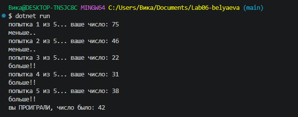
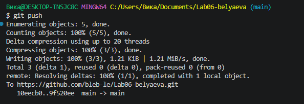

# Практическая работа №6. Циклы

**ФИО:** беляева виктория дмитриевна
**Группа:** ИСП-241
**Дата:** 25.11.2026(время 2:22!!)

## Что изучено

- научилась пользоваться циклом `for`. когда заранее известно, сколько раз надо что-то повторить
- узнала, чем `while` отличается от `do while`. в `while` условие проверяется до тела цикла, в `do while` условие проверяется после, и тело выполнится хотя бы один раз
- поняла, как работают `break` и `continue`, `break` полностью останавливает цикл, а `continue` только пропускает текущий шаг!

## Скриншоты

